# AtölyeKart — Luna Atelier

Luna Atelier için bir atölye vitrini: el yapımı seramik, doğal mum ve aksesuar. Ziyaretçi ürünleri sepete ekleyip sipariş talebi ya da stok bildirimi bırakır; talepler güvenli bir API üzerinden n8n'deki atölye workflow'una iletilir. Sağ alttaki **AtölyeKart Asistan**, ürün bakım rehberlerine dayanarak soruları yanıtlar ve konuşmayı hatırlar.

| Parça | Nerede | Ne yapar |
| --- | --- | --- |
| Web | `src/`, `index.html`, `gizlilik.html` | React + Vite vitrin (Luna tasarımı), sepet ve sipariş talebi, asistan penceresi, gizlilik politikası |
| API | `api/`, `server/` | Doğrulama, stok kontrolü, rate limit, imzalı webhook, sohbet proxy'si (`/api/chat`), admin uç noktası |
| Mobil | `mobile/` | Expo uygulaması (SDK 58); aynı API'yi kullanır |
| n8n | ayrı sunucu | Sipariş ve stok bildirimi workflow'u, RAG asistan (Redis hafıza + Qdrant dokümanları), hata ağı |

- Canlı adres: https://atolyekart-tawny.vercel.app
- Hafta 6 teslim belgeleri: [`docs/hafta6/`](docs/hafta6/)

## Ekran görüntüleri

Görüntüler production sitesinden alındı (22.11.2026).

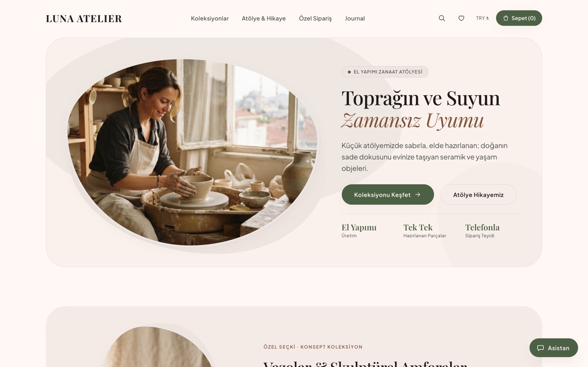

| Sepet bildirimi | Eksik alan mesajı |
| --- | --- |
| 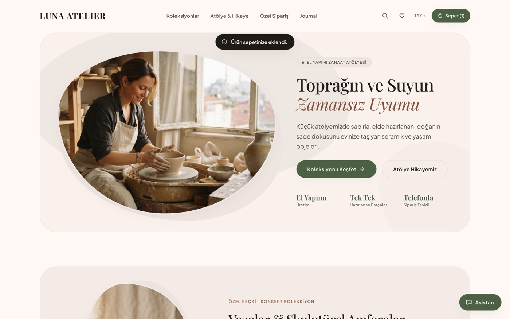 | 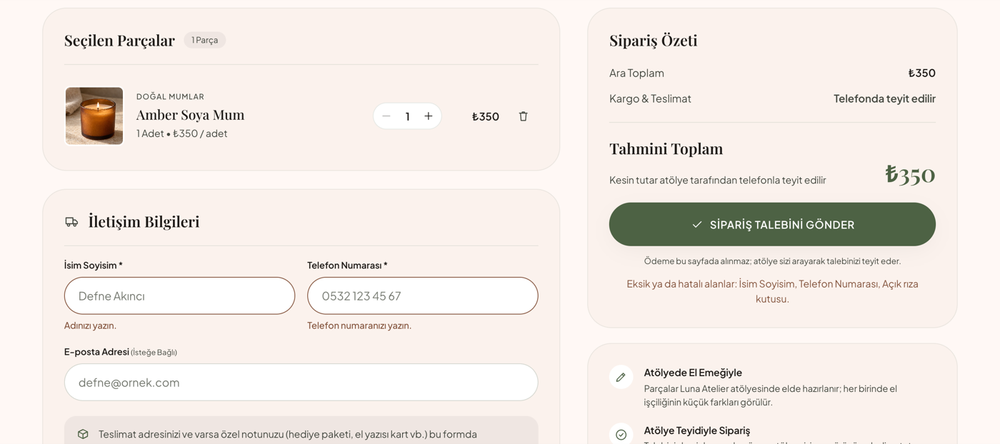 |

| Sipariş talebi alındı | AtölyeKart Asistan |
| --- | --- |
| 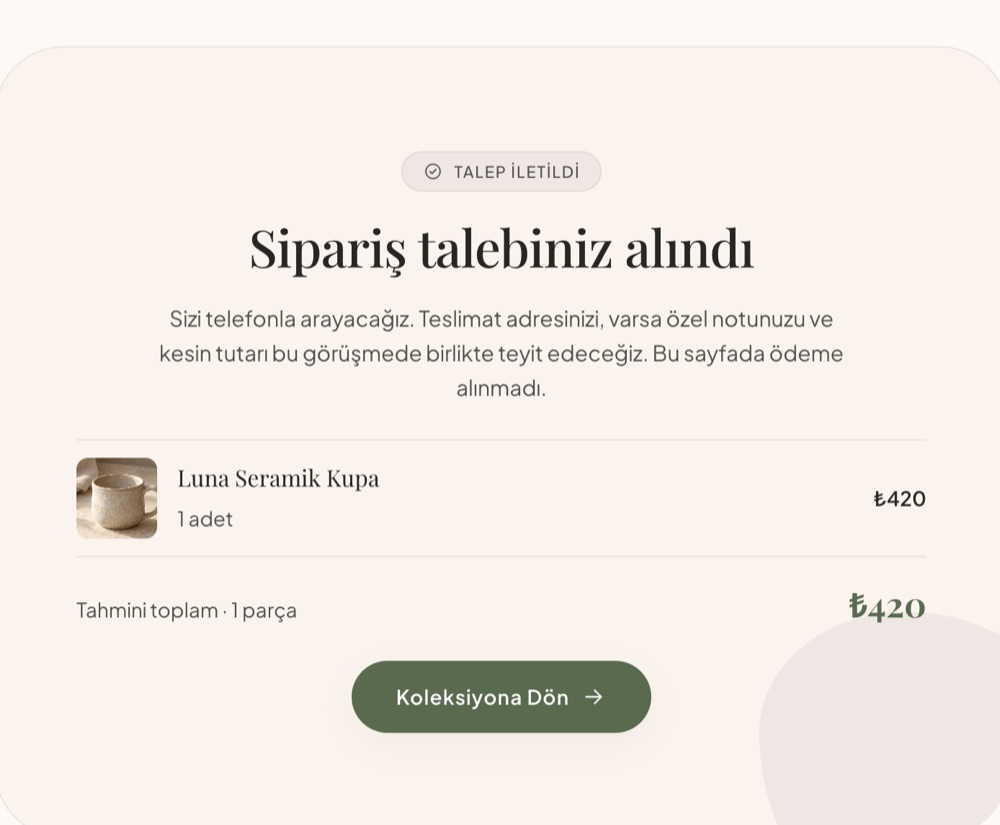 | 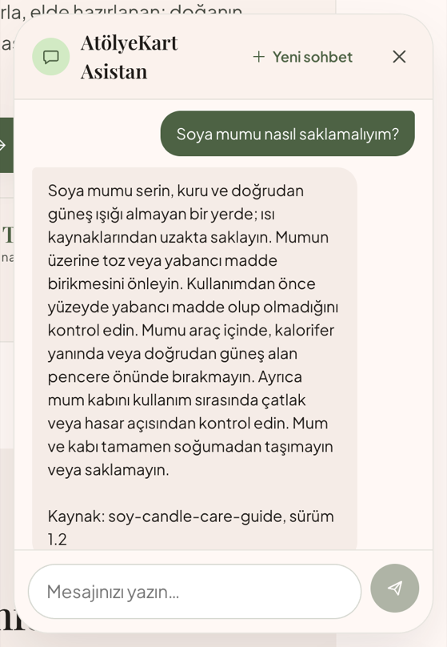 |

Asistan örneği: "Soya mumu nasıl saklamalıyım?" sorusunun cevabı soya mum bakım rehberinden gelir ve sonunda kaynak satırı bulunur. Konuşma Redis'ten geri yüklenmiştir.

### Mobil (Expo Go, iPhone)

Ad ve e-posta alanları görüntüden silinmiştir.

| Stok bildirimi formu | Açık rıza | Sonuç |
| --- | --- | --- |
| 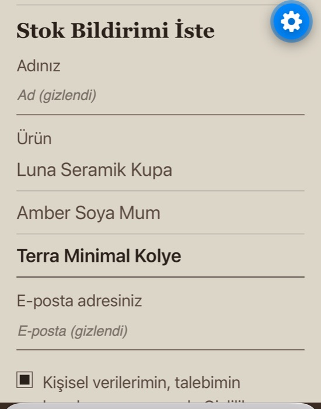 | 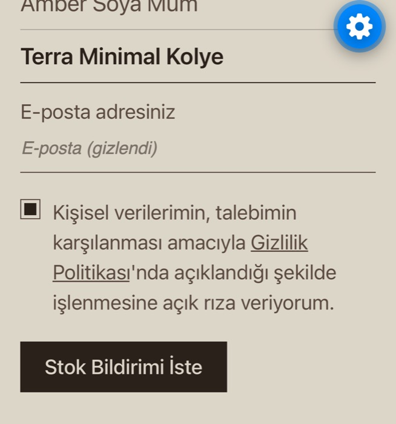 | 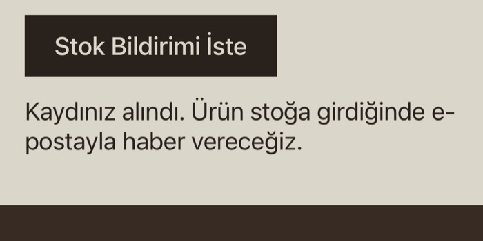 |

## Mimari

```
Tarayıcı / mobil ──► /api (Vercel Function) ──► n8n
                      doğrulama, açık rıza,      ├─ atolyekart-siparis: sipariş → Validation → Google Sheets → AI e-posta taslağı
                      stok, rate limit,          │                      stok bildirimi → "Stok Bildirimleri" sayfası
                      HMAC imza, sırlar          ├─ AtolyeKart-RAG-Product-Knowledge: gpt-4.1-mini + Redis hafıza + Qdrant
                      yalnızca sunucuda          └─ Atolyekart-Error-Handler: workflow hatalarını yakalar
```

Tarayıcı ve mobil uygulama yalnızca `/api`'yi bilir; n8n adresi ve kimlik bilgileri istemci paketinde yoktur.

### n8n iş akışları

Görüntüler n8n editöründen alındı. Workflow'lar MCP ile incelendi ve güncellendi; değişiklikler önce TEST kopyasında denendi.

**Sipariş ve stok bildirimi (`atolyekart-siparis`).** Webhook olayın türüne göre ayrılır. Sipariş, `Atolyekart-Validation` alt workflow'unda doğrulanır, Google Sheets'e yazılır ve AI Agent bir e-posta taslağı hazırlar (taslak gönderilmez). Stok bildirimi ayrı dalda doğrulanıp "Stok Bildirimleri" sayfasına yazılır. Her dal sonucunu kendi yanıtıyla döner: kaydedildi, geçersiz veri ya da kayıt başarısız.

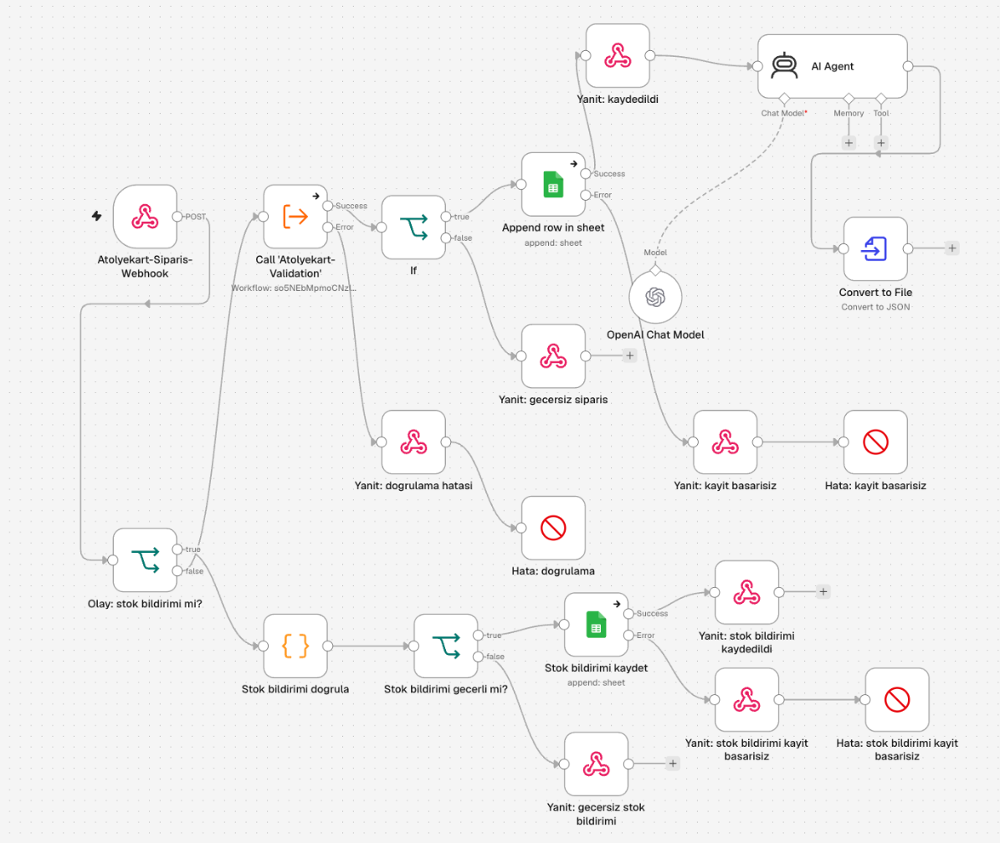

**AtölyeKart Asistan (`AtolyeKart-RAG-Product-Knowledge`).** Chat Trigger Basic Auth ile korunur. AI Agent (`gpt-4.1-mini`) ürün dokümanlarını "Product Documents" aracıyla Qdrant'tan (`topK` 6) okur; konuşma "Redis Chat Memory" içinde oturum kimliğine göre 30 gün saklanır.

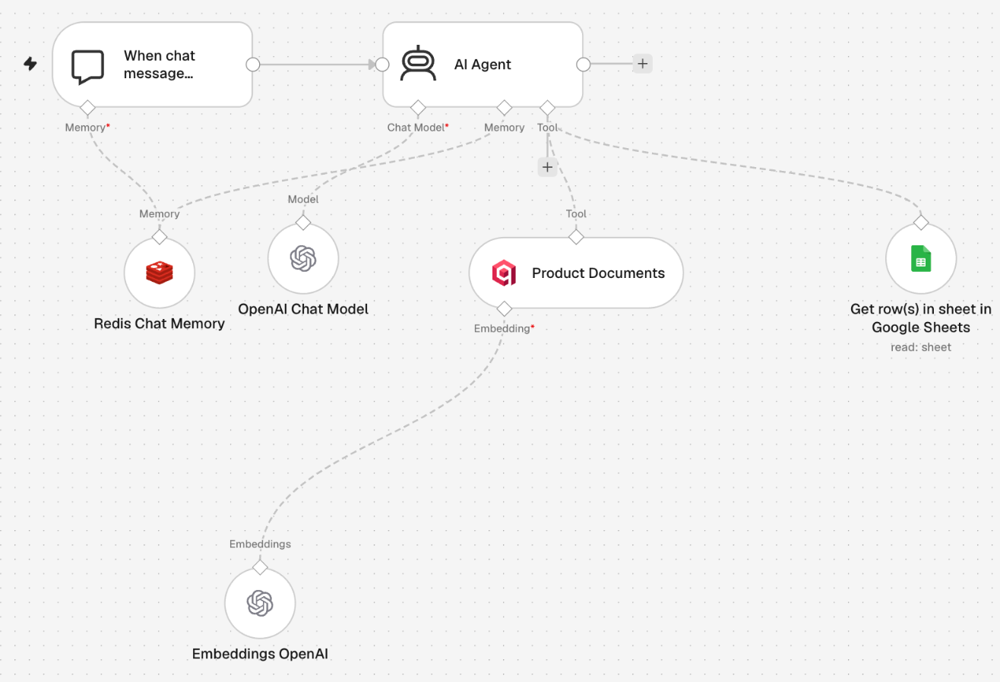

**Hata ağı (`Atolyekart-Error-Handler`).** Workflow'larda oluşan hataları Error Trigger ile yakalar.

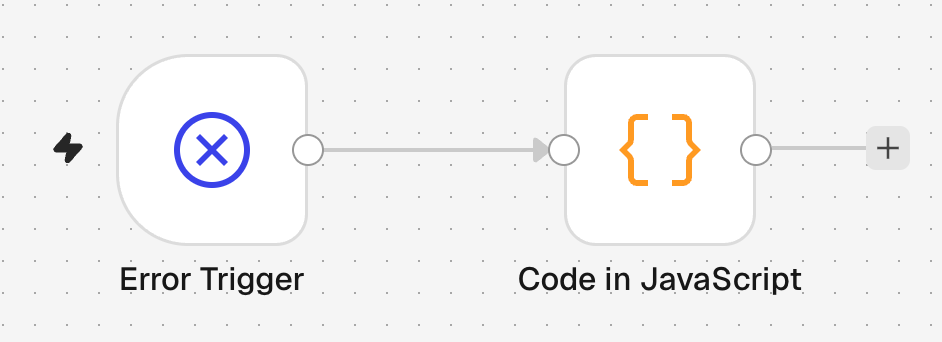

## Yerel geliştirme

Node.js 22 ya da üstü gerekir.

```sh
npm install
cp .env.example .env.local   # sonra değerleri .env.local içinde doldurun
npm run dev                  # http://localhost:5173 — sayfa ve /api birlikte
npm test                     # doğrulama, API ve sohbet testleri (node:test)
npm run build                # üretim derlemesi (dist/)
```

`npm run dev`, `/api` isteklerini Vercel'de çalışan kodun aynısına verir; `vercel dev` gerekmez. `.env.local` içinde `WEBHOOK_URL` boşsa webhook'a istek atılmaz, olay terminale `[webhook:mock]` ile yazılır. `N8N_CHAT_*` değişkenleri boşsa `/api/chat` 503 döner.

## Ortam değişkenleri

Adlar ve biçim `.env.example` içindedir. Gerçek değerler yerelde `.env.local` (depoya girmez), canlıda Vercel Environment Variables içinde durur.

| Değişken | Nerede okunur | Gizli mi | Açıklama |
| --- | --- | --- | --- |
| `WEBHOOK_URL` | sunucu | evet | Taleplerin iletildiği n8n webhook adresi. Canlıda zorunlu |
| `WEBHOOK_SECRET` | sunucu | evet | Webhook imzası için HMAC anahtarı. Canlıda zorunlu |
| `JWT_SECRET` | sunucu | evet | Admin JWT imza anahtarı, en az 32 karakter |
| `N8N_CHAT_URL` | sunucu | evet | n8n Chat Trigger adresi; `https` olmalı (yalnızca `localhost` için `http`) |
| `N8N_CHAT_USER` | sunucu | evet | Chat Trigger Basic Auth kullanıcı adı |
| `N8N_CHAT_PASSWORD` | sunucu | evet | Chat Trigger Basic Auth parolası |
| `VITE_API_URL` | tarayıcı | hayır | API kök adresi. Boşsa aynı alan adı; `mock:` ağ isteği yapmaz |
| `VITE_CATALOG_URL` | tarayıcı | hayır | QR kodun adresi. Boşsa sayfanın kendi adresi |

`VITE_` önekli her değişken tarayıcı paketine girer ve herkes okuyabilir; sırlara bu önek verilmez. Anahtar üretmek için: `openssl rand -hex 32`. Yerel ve canlı için ayrı anahtar kullanın.

## Vercel'e deploy

Proje Vercel'e ve GitHub'a bağlıdır; `main` dalına yapılan push Production deploy'unu başlatır. Ayarlar `vercel.json` içindedir: Vite derlemesi `dist/` klasörüne çıkar, tüm `/api/*` istekleri tek fonksiyona (`api/index.js`) yönlenir.

1. Vercel → Project → Settings → Environment Variables altında **Production** için yukarıdaki sunucu değişkenlerini girin (panelden; değerler terminale ya da depoya yazılmaz).
2. Tanımlı olduklarını kontrol edin (yalnızca adları listeler):
   ```sh
   vercel env ls production
   ```
3. `main` dalına push edin ya da elle deploy edin: `vercel deploy --prod`.

Ortam değişkeni değişikliği yalnızca yeni deploy'da geçerli olur. Canlıda `WEBHOOK_URL` ya da `WEBHOOK_SECRET` eksikse formlar `502`, `JWT_SECRET` eksikse admin uç noktası `503`, `N8N_CHAT_*` eksikse `/api/chat` `503` döner.

## API

Form ve admin yanıtları JSON'dır. Başarı: `{ "ok": true }`. Hata: `{ "ok": false, "error": "<kod>", "message": "<Türkçe metin>" }`; doğrulama hatasında ayrıca `errors: { "<alan>": "<metin>" }`. Yanıtlarda teknik ayrıntı ya da stack trace bulunmaz.

| Uç nokta | Yöntem | Yetki | Gövde |
| --- | --- | --- | --- |
| `/api/order` | `POST` | yok (herkese açık) | `name`, `productId`, `quantity`, `phone`, `email` (isteğe bağlı), `consent`, `source` |
| `/api/stock-request` | `POST` | yok (herkese açık) | `name`, `productId`, `email`, `consent`, `source` |
| `/api/chat` | `POST` | aynı origin | `action` (`sendMessage` / `loadPreviousSession`), `sessionId`, `chatInput` |
| `/api/admin/orders` | `GET` | Bearer JWT, `role: "admin"` | — |

| Durum | Anlamı |
| --- | --- |
| `200` | Kabul edildi ve webhook'a iletildi |
| `400` | Doğrulama hatası, eksik açık rıza (`consent` tam olarak `true` olmalı) ya da bozuk gövde |
| `401` / `403` | Admin: token yok, geçersiz ya da süresi dolmuş / rol admin değil. Sohbet: farklı origin (`403`) |
| `405` | İzin verilmeyen yöntem |
| `409` | Stok kuralı: stokta olmayana sipariş (`out_of_stock`), stokta olana stok bildirimi (`in_stock`) |
| `415` | Sohbet: gövde JSON değil |
| `429` | Rate limit; `Retry-After` başlığı kaç saniye bekleneceğini söyler |
| `502` | Webhook'a ya da n8n'e iletilemedi |
| `503` | Sunucu yapılandırması eksik |
| `504` | Sohbet: n8n zaman aşımı |

Sunucu istemciye güvenmez: tüm alanları yeniden doğrular, ürün adını ve stok durumunu kendi kataloğundan alır (`server/lib/catalog.js`); istemcinin gönderdiği `productName` yok sayılır. Şu an Terra Minimal Kolye stokta yok, diğer iki ürün stokta. Sipariş stok düşürmez.

Örnek:

```sh
curl -i -X POST http://localhost:5173/api/order \
  -H 'Content-Type: application/json' \
  -d '{"name":"Ayşe Yılmaz","productId":"luna-seramik-kupa","quantity":2,"phone":"0532 123 45 67","consent":true,"source":"react"}'
```

Webhook'a giden olayın biçimi ve imzası: `.claude/skills/atolyekart-standartlari/webhook-format.md`.

### Sepet ve sipariş talebi

Sepet tarayıcı belleğinde tutulur ve yalnızca gerçek ürünleri kabul eder. Her sepet satırı ayrı bir `POST /api/order` isteğidir; başarısız satır mesajıyla sepette kalır, sepet yalnızca tüm satırlar başarılı olunca temizlenir. Gönderim yalnızca Vercel Production'da gerçek sipariş sayılır; yerel geliştirme "test" modundadır, Preview'da gönderim kapalıdır (`checkout/orderMode.js`).

### AtölyeKart Asistan (`/api/chat`)

Tarayıcı n8n'i doğrudan çağırmaz; `src/features/luna-atelier-preview/chat/chatClient.js` aynı alan adındaki `/api/chat`'e yazar. Proxy (`server/routes/chat.js`):

- yalnızca aynı origin'den gelen JSON istekleri kabul eder;
- gövdeyi yalnızca izinli alanlarla yeniden kurar ve ziyaretçinin IP'sini n8n'e iletmez;
- n8n'e Basic Auth ile gider (zaman aşımı 85 sn, geçmiş yüklemede 15 sn);
- yanıttaki araç çağrılarını ve sistem mesajlarını süzer.

Oturum kimliği tarayıcıda `localStorage['atolyekart-chat-session']` içindedir; pencere yeniden açıldığında son 50 mesaj geri yüklenir. "Yeni sohbet" yalnızca tarayıcıda yeni bir kimlik üretir; sunucudaki eski kayıt silinmez ve pencerede bu açıkça yazar. Günlüklerde mesaj içeriği bulunmaz.

Bilinen sınırlama: model bazen dokümandaki bir öneriyi cevabın sonunda kesin bir hükme çevirebilir. Ayrıntı: `docs/hafta6/uretim-hazirlik.md`.

### Admin uç noktası ve JWT

JWT yalnızca `/api/admin/orders` içindir; ziyaretçi formları token istemez. Uç nokta HS256 ile imzalanmış, `role: "admin"` ve geçerli `exp` taşıyan bir token bekler.

```sh
# Yerel sunucu için: .env.local içindeki JWT_SECRET ile 15 dakikalık token
TOKEN=$(node --env-file=.env.local scripts/admin-token.mjs)
curl -H "Authorization: Bearer $TOKEN" http://localhost:5173/api/admin/orders
```

Canlı sunucu canlı `JWT_SECRET` ile imzalanmış token ister: `JWT_SECRET=… node scripts/admin-token.mjs` (değeri kabuk geçmişine yazmamak için komutun başına bir boşluk koyun ya da `read -s JWT_SECRET` kullanın). İkinci argüman rolü değiştirir (`… admin-token.mjs 15 user` → `403` denemesi). Token'ı paylaşmayın, depoya yazmayın.

Uç nokta, o fonksiyon instance'ının belleğindeki son siparişleri (en fazla 50) döner; veritabanı yoktur, instance yeniden başlayınca liste boşalır.

### Rate limiting

- **Formlar ve admin:** IP başına dakikada 10 istek, ortak sayaç.
- **Sohbet:** IP başına dakikada 20 istek; dakikada 6 ve saatte 60 mesaj.
- **Vercel WAF:** `/api/chat` POST için IP başına dakikada 30 istek (production ve Preview).

Aşılırsa `429` ve `Retry-After` döner. Uygulamanın kendi sayaçları bellek içidir; Vercel'de her fonksiyon instance'ının belleği ayrıdır ve cold start'ta sıfırlanır, yani sınır instance başınadır (`server/lib/rate-limit.js`). WAF kuralı bu sayaçlara ek olarak platform düzeyinde çalışır.

### Haftalık sipariş sorgusu (n8n API)

```sh
node --env-file=.env.local scripts/haftalik-siparis-api.mjs
```

n8n REST API'den yalnızca `GET` ile 16–22 Kasım 2026 (Europe/Istanbul) haftasının başarılı `atolyekart-siparis` çalışmalarını listeler. `.env.local` içinde `N8N_API_URL` ve `N8N_API_KEY` ister; anahtarı ve adresi yazdırmaz.

## KVKK

Sipariş ve stok bildirimi formlarında açık rıza kutusu vardır; işaretlenmeden form gönderilmez ve sunucu da reddeder. `/gizlilik.html` hangi verilerin neden toplandığını, saklama sürelerini, hakları ve iletişimi anlatan **örnek bir taslaktır**: hukuki danışmanlık değildir, şirket bilgileri köşeli parantezli yer tutucudur.

Güvenlik maddelerinin tamamı: `GUVENLIK-KONTROL-LISTESI.md`.

## Mobil uygulama (Expo)

`mobile/` ayrı bir Expo projesidir (kendi `package.json`'ı vardır; web projesine bağımlılık eklemez). Ürün verisini (`src/products.js`), doğrulamayı (`src/webhook/validation.js`) ve istek gövdesini (`src/webhook/payload.js`) web ile paylaşır; talepleri aynı `/api` uç noktalarına gönderir. Uygulamada sır yoktur. Mobil uygulama ilk tasarımdadır; Luna tasarımı, sepet ve asistan yalnızca web'dedir.

```sh
cd mobile
npm install
npx expo start
```

### Expo Go ile telefonda açma

1. Telefona **Expo Go** uygulamasını kurun (App Store / Google Play). Uygulama Expo SDK 58 kullanır; Expo Go güncel olmalı.
2. Telefon ve bilgisayar aynı Wi-Fi ağında olsun.
3. `npx expo start` terminalde bir QR kod gösterir. iOS'ta Kamera uygulamasıyla, Android'de Expo Go içindeki "Scan QR code" ile okutun.
4. Aynı ağda bağlanamıyorsanız: `npx expo start --tunnel`.

Uygulama varsayılan olarak canlı API'yi kullanır (`https://atolyekart-tawny.vercel.app`). Yerel API'yi denemek için kök klasörde `npm run dev -- --host` çalıştırın ve `mobile/.env.local` içine bilgisayarın ağ adresini yazın:

```sh
EXPO_PUBLIC_API_URL=http://192.168.1.20:5173
```

`EXPO_PUBLIC_` önekli değişkenler uygulama paketine girer; sır yazılmaz. Ürün fotoğrafları da bu adresten yüklenir.

## Yapı

```
src/            React uygulaması, ürün verisi, doğrulama ve API adapter'ı
  features/luna-atelier-preview/   Luna tasarımı: sepet, sipariş talebi, asistan penceresi
api/            Vercel Function girişi (tek fonksiyon)
server/         yönlendirici, rotalar (order, stock-request, admin-orders, chat), doğrulama, rate limit, JWT, webhook, testler
scripts/        admin-token.mjs (yerel JWT üretici), haftalik-siparis-api.mjs (n8n API sorgusu)
mobile/         Expo uygulaması
public/         ürün ve hero fotoğrafları, fontlar (SIL OFL 1.1)
docs/hafta6/    Hafta 6 teslim, üretim hazırlığı ve hukuki inceleme notları
docs/images/    README ekran görüntüleri
DESIGN.md       tasarım sistemi
CLAUDE.md       proje kapsamı ve kuralları
GUVENLIK-KONTROL-LISTESI.md
```

## Lisans notları

- Fontlar: Brygada 1918 ve Hanken Grotesk, SIL Open Font License 1.1 (`public/fonts/OFL-*.txt`).
- QR kod: [qrcode-generator](https://github.com/kazuhikoarase/qrcode-generator), MIT.
